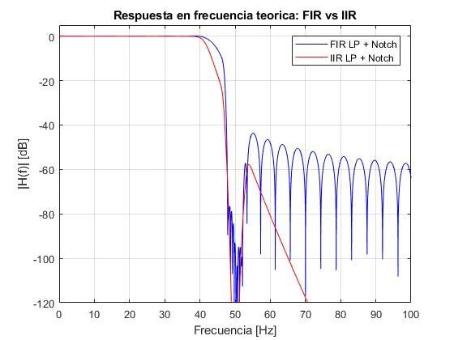

# Diseño y comparación de filtros digitales FIR/IIR aplicados al procesamiento de señales ECG

**Nicolás Fontana · Nicolás Molo · Malena Silvestre** · Técnicas Digitales III · Ingeniería Electrónica · UTN Facultad Regional Paraná · 2026.

Se estudió cómo reducir ruido de alta frecuencia e interferencia cercana a 50 Hz conservando la forma del ECG. Se compararon dos cascadas en MATLAB con el registro 118e00 de MIT-BIH Noise Stress Test Database. El trabajo también describe un sistema experto de selección y ensayos con ESP32.

- [Especificaciones, ecuaciones y estructuras](docs/diseno.md)
- [Simulación, resultados y revisión numérica](docs/resultados.md)
- [Sistema experto, implementación y evidencia de banco](docs/implementacion.md)

Fuente primaria: *Examen Parcial Integrador*, Técnicas Digitales III, 2026. Se conservan las figuras 26 y 33 del trabajo grupal. Los scripts, firmware, WebApp, vectores de coeficientes completos y archivos de muestras no se adjuntaron como originales.
