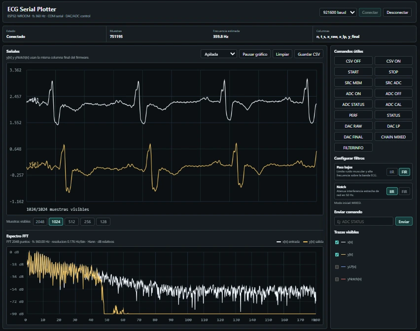

# Selección de estructura y prueba embebida

**Decisión asistida.** El módulo Python descrito en pp. 47–51 es un sistema experto de reglas IF–THEN. Pondera exigencia de fase lineal, latencia, ruido, memoria y operaciones por muestra. Las reglas favorecen el FIR para conservar forma temporal y el IIR para transiciones estrechas con recursos limitados. Para el sistema ECG completo considera una solución híbrida. Los puntajes son criterios de ingeniería definidos por los autores.

**Implementación reportada.** En la NodeMCU ESP32s, el modo MIXED combina el pasa bajos FIR Kaiser con el notch IIR en secciones de segundo orden. El firmware C/C++ utiliza un búfer de muestras para el FIR y estados por sección para el IIR. La temporización se realiza mediante consulta de micros(). El ensayo principal reproduce 5.000 muestras desde memoria a 360 muestras/s. La aplicación local usa Web Serial para recibir CSV por UART y mostrar series temporales y FFT (pp. 52–61).

Figura 33, p. 61. La figura 34 del informe muestra además una senoide de 25 Hz inyectada al ADC. Es una prueba de banco con entrada conocida. El DAC permite observación cualitativa y la salida serie conserva mayor resolución. No se dispone del registro bruto del ensayo, mediciones de jitter ni adquisición clínica con electrodos. El informe documenta hardware y software, pero los originales ejecutables no formaron parte de los adjuntos.
